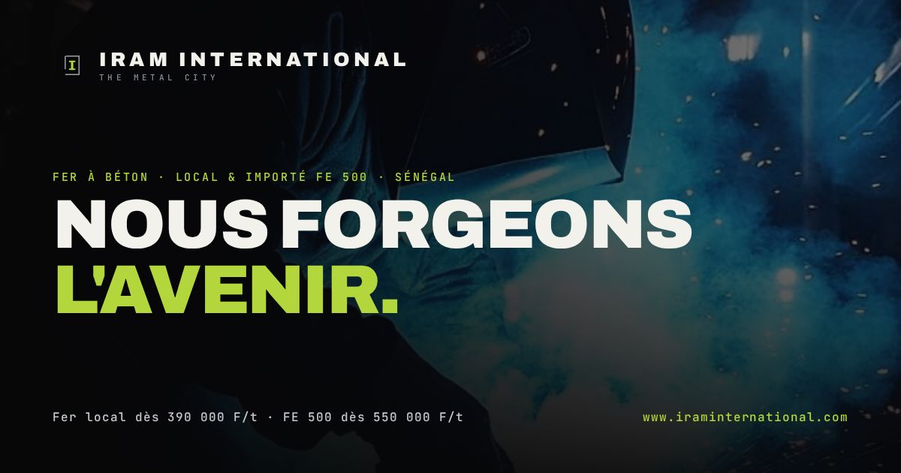

<div align="center">



# IRAM International — The Metal City

**Site vitrine immersif et bilingue pour un distributeur de fer à béton et matériaux de construction (Dakar, Sénégal · livraison Sénégal & Mali).**

[](https://www.iraminternational.com)
&nbsp;


</div>

---

## 🏗️ À propos

**IRAM International** (*International & Regional African Metal — « The Metal City »*) distribue du fer à béton local et importé **FE 500**, du béton prêt à l'emploi et des matériaux de construction premium. Basée à Dakar, l'entreprise livre au **Sénégal et au Mali**.

Ce dépôt héberge le site vitrine : une expérience **cinématique, immersive et bilingue (FR / EN)**, pensée pour transformer un visiteur en demande de devis.

🔗 **En ligne : [www.iraminternational.com](https://www.iraminternational.com)**

---

## ✨ Fonctionnalités

- **Bilingue FR / EN** — bascule instantanée de toute la page.
- **Configurateur de devis interactif** — choix du produit (Fer local FE 400 / FE 500, importé FE 500, béton), diamètre, tonnage → **estimation en direct**, envoi **WhatsApp** ou **e-mail**, et **devis PDF** téléchargeable (jsPDF).
- **Film de présentation** intégré en plein écran.
- **Direction artistique HUD / industrielle** — fond noir & vert chartreuse, animation des lettres (scramble), curseur personnalisé, particules, révélations cinématiques au scroll.
- **Défilement fluide** (Lenis) et **galerie lightbox**.
- **Catalogue & fiche technique PDF** téléchargeable.
- **FAQ**, bouton **« Rappelez-moi »**, carte contact avec agent commercial.
- **SEO complet** — title/description optimisés, Open Graph, Twitter Card, **données structurées JSON-LD** (HardwareStore), `sitemap.xml`, `robots.txt`, favicon.
- **Responsive** (mobile-first) et **HTTPS**.
- **Google Analytics 4** prêt à l'emploi.

---

## 🛠️ Stack technique

| Domaine | Technologies |
|---|---|
| Base | HTML5, CSS3, JavaScript **vanilla** (zéro framework) |
| Animations | Lenis (smooth scroll), Canvas, CSS clip-path & keyframes |
| Devis PDF | jsPDF |
| Hébergement | GitHub Pages + domaine personnalisé + HTTPS |
| SEO / Analytics | JSON-LD, sitemap, robots.txt, Google Analytics 4 |

Le site est un **fichier `index.html` autonome** (CSS + JS inline) — léger, rapide, sans build.

---

## 📁 Structure

```
index.html         → le site (tout-en-un)
catalogue.pdf      → catalogue & fiche technique
favicon.svg        → icône
og.jpg             → aperçu réseaux sociaux (1200×630)
sitemap.xml        → plan du site
robots.txt         → règles d'indexation
CNAME              → domaine personnalisé
assets (images/vidéos) → hero, chantiers, produits…
```

---

## 🌍 Contact

**IRAM International** — 105 Ngor Extension, Dakar, Sénégal · NINEA 12502424
WhatsApp **+221 77 885 53 66** · Bureau **+221 77 615 81 25** · IramInternationalsn@gmail.com

---

<div align="center">
<sub>Conçu & développé sur mesure — design immersif, configurateur de devis et SEO inclus.</sub>
</div>
